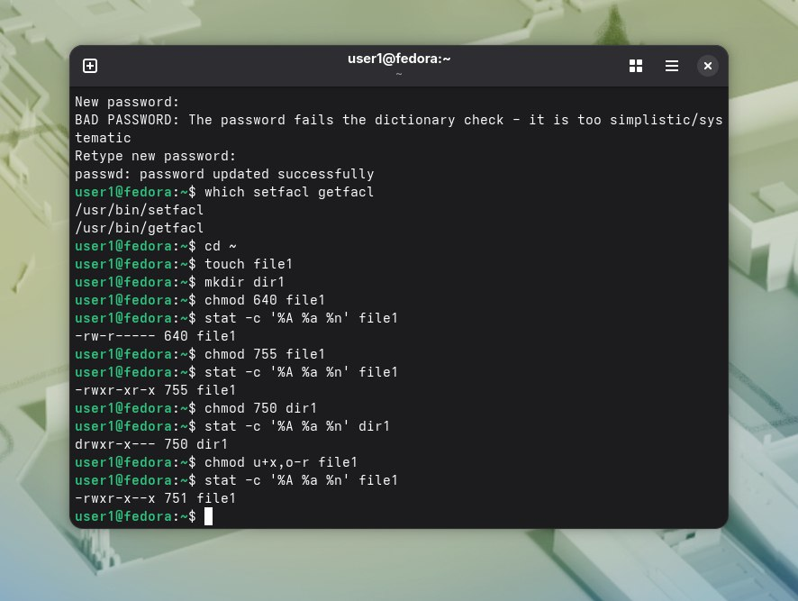

Вывод stat (4 шт.):  
.  
Вопрос 1). 
А)644. 
Б)750. 
В)600. 
Г)555. 
Вопрос 2)Х означает право на выполнение файла,как программы или скрипта.В случае с каталогом,означает право входа в него.  
Вопрос 3)Выдались бы все права на все файлы,в том числе системные.Любой пользователь мог бы удалить системные файлы.
