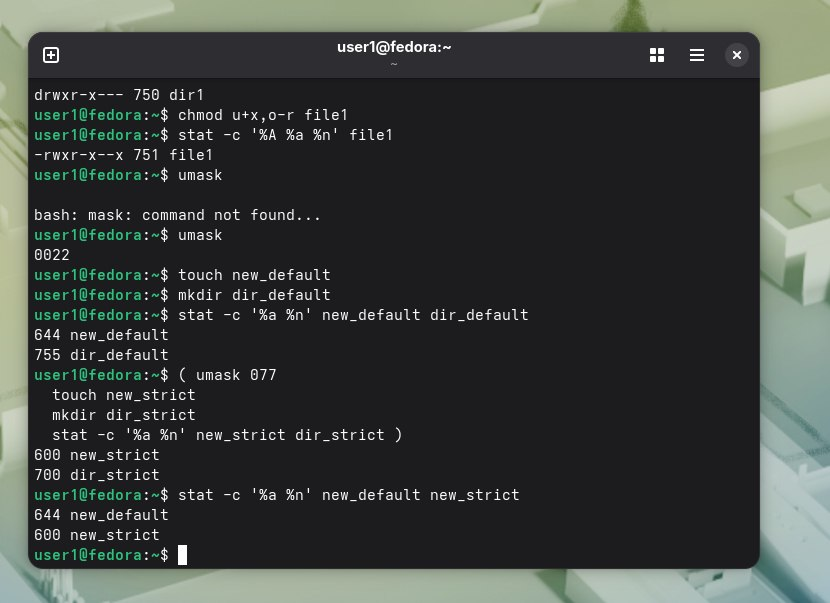

Вывод прав при разных масках:  
.  
Расчет). 
Обычная(022)-для файлов:666-022=644.Для каталогов: 777-022=755.  
Если нужна конфиденциальность(077)-для файлов:666-077=600.Для каталогов:777-077=700.  
Вопрос 1)Большинству создаваемых файлов не нужно быть исполняемыми,поэтому по умолчанию этого права нет,это создало бы дыру в безопасности.А в каталогах х значит возможность в них зайти.Без него каталог бесполезен.  
Вопрос 2)Это гарантирует,что создаваемые файлы будут доступны только владельцу.
