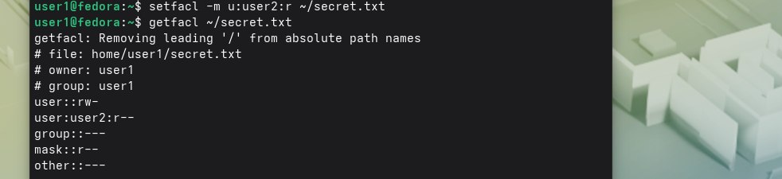
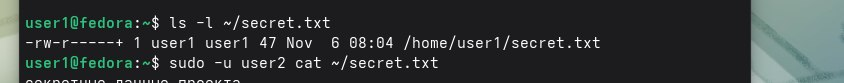
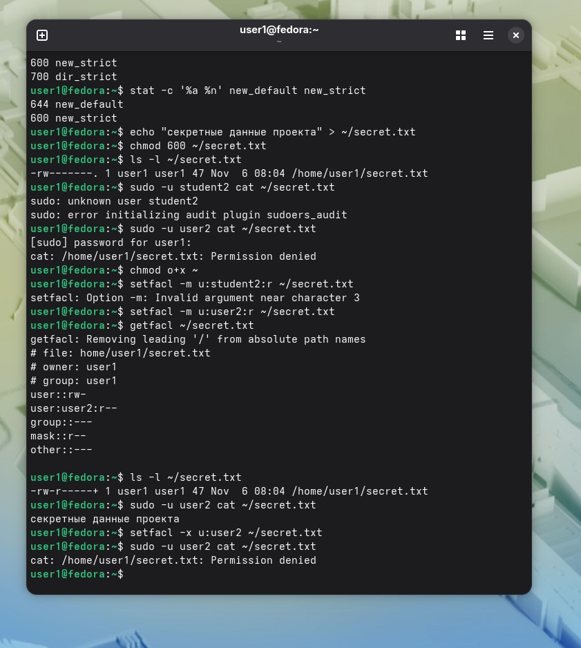

Вывод getfacl:  
.  
Вывод ls -l(Это важно,потому что это может означать риск утечки данных и требовать дополнительной проверки):  
.  
Результаты cat:  
.  
Вопрос 1)Добавляя кого-то в группу,вы даёте ему доступ ко всем файлам,где группа имеет права.С помощью acl можно выдать права на 1 файл,что соответствует принципу наименьших приведений.  

