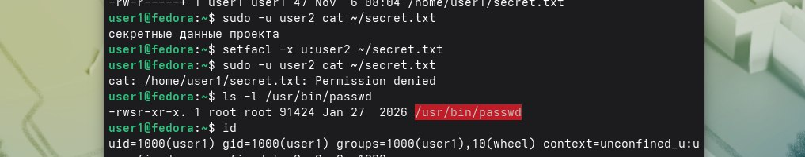
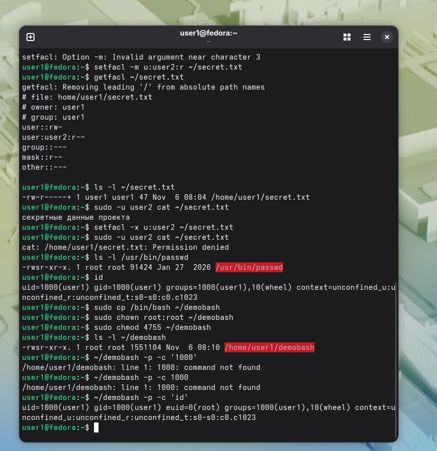

 Вывод ls -l /usr/bin/passwd(suid - буква s в правах):  
 .  
Вывод ls -l ~/demobash и id:  
.  
Вопрос 1)Эффективный идентификатор пользователя- то,от чьего имени процесс фактически выполняет действия.0 значит root.

Вопрос 2)Потому что он содержит хэши паролей, и поэтому записать в него может только root.Мы не root,а вот процесс с suid -теэнически да,она имеет его права из за suid.
