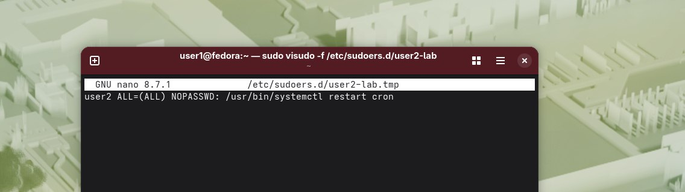
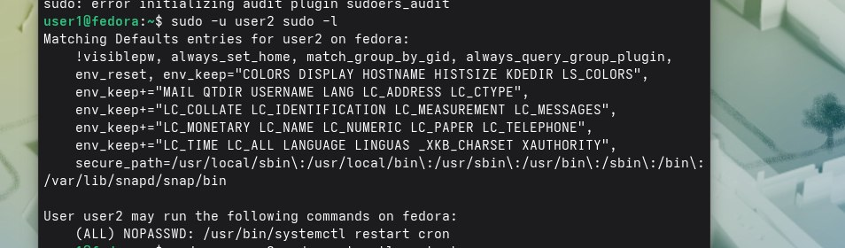
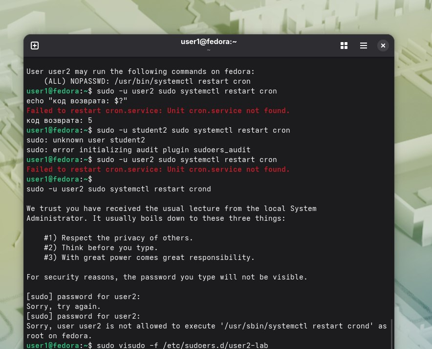

Файл правил:  
. 
Вывод sudo -l:  
. 
Результаты проверки:  
. 

Вопрос 1)Ошибка в этом файле может привести к полной потере доступа к sudo.Это рискованно.
А visudo проверяет синтаксис,блокирует файл на время редактирования, и сначала записывает изменения во временный файл,что устраняет проблему.  
Вопрос 2)Потому что это фактически даст ему права root.
